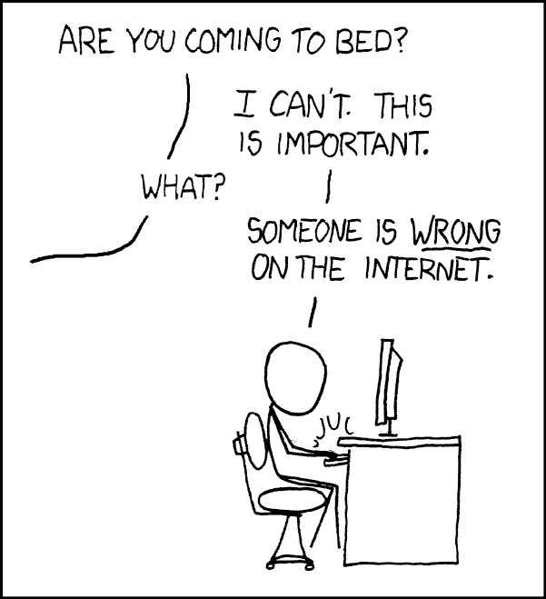

+++
date = 2026-10-20T13:49:12+02:00
title = "Feedback at every step"
description = "Agile development, quick feedback, and merged code."
tags = []
slug = "merged-code-feedback"
+++
<figure>
  
  <figcaption>
    
A classic xkcd comic. ([source](https://xkcd.com/386/))

  </figcaption>
</figure>

A while ago, someone was wrong on the Internet, and I couldn't let it go[^2]. :smile: A [LinkedIn post][pr-modified-files] asked whether small PRs are only justified for hotfixes, or if they have broader value, and what the maximum number of changed files should be before a PR gets pushed back for splitting.

[pr-modified-files]: https://www.linkedin.com/posts/anton-pronin-8b81a916_techlead-cto-pullrequest-activity-7441079542003208192-lEfg

Beyond the obvious point that the number of files is irrelevant, I think a pull request's upper size limit depends on the change's complexity[^1] and on keeping feedback loops short.

[cunningham]: https://hacker-laws.com/#cunninghams-law
[^1]: The unit of "change", in the case of the LinkedIn post, is a pull request.
[^2]: Obligatory reference to [Cunningham's Law][cunningham].

When people think about feedback loops in the flow of software engineering, there is a tendency to only focus on the explicit customer feedback loop. "Put **it** in the hands of the customer ASAP!", they say. But what is "it", really? Most people think of "it" as "the new customer feature". I think of it as "a change", any change really. For example, if you have refactored some code, ship it immediately. Or, if you have discovered a bug while implementing a new feature, ship that bug immediately.

## Feedback is not only from your customers

So what is *feedback* in terms of shipping code, really? I think people have this mental model when developing software (or any product, really):

<figure>

sequenceDiagram
    actor Developer
    actor Customer
    Note over Developer: "Write 100% of the code needed for the feature"
    loop While the customer is not happy...
        Developer->>Customer: Ship or adjust the feature
        Note over Customer: Customer uses the new feature
        Customer->>Developer: Let the Developer know if the feature was useful
    end

<caption>Mental model: feedback only comes from customers</caption>
</figure>

The above mental model figure is really too simplified. For anyone who has read the classic book [Continuous Delivery by Jez Humble][cd-book], you know that shipping software can be thought of as a pipeline:

[cd-book]: https://www.amazon.com/dp/0321601912

<figure>

sequenceDiagram
    actor Developer
    participant Workstation
    participant Review as Code review system
    actor Colleague as Colleague(s)
    participant CI as Test runner
    participant Backend
    actor Customer

    loop While customer is not happy...
      loop Until the code works on Backend...
        loop Until code review passes and pre-merge tests passes...
          loop Until it compiles...
            Developer->>Workstation: Coding
            Workstation-->>Developer: Compilation error
          end
          Developer->>Workstation: Submit code for review
          Workstation->>Review: Code is sent for review
          par Code review
            Review->>Colleague: Human/AI code review
            Colleague->>Developer: Human/AI feedback on implementation
          and Pre-merge tests
            activate CI
            CI->>CI: Execute unit tests
            CI->>CI: Execute integration tests
            CI->>CI: Execute system tests
            break
              CI->>Developer: Notify tests failed
            end
            CI->>Developer: Notify tests passed
            deactivate CI
          end
        end
        Developer->>Review: Submit for merging
        Review->>CI: CI/CD initiated
        activate CI
        CI->>CI: Merge trunk to run integrated tests
        CI->>CI: Execute unit tests
        CI->>CI: Execute integration tests
        CI->>CI: Execute system tests
        break
          CI-->>Developer: Notify of test failure
        end
        CI-->>Backend: Tests passed and deploy initiated
        loop Until all smoke tests have executed or failure
          CI->>Backend: Make requests
          Backend->>CI: Check response
        end
        break
          CI->>Developer: Notify of deployment failure
        end
        CI->>Developer: Notify of deployment success
        deactivate CI
      end
      Backend->>Developer: Backend observability
      par General product usage
        Backend->>Customer: Customer uses product generally
        Customer->>Developer: Support request to notify if a preexisting feature is broken
      and Trying new features
        Backend->>Customer: Customer tries a new product feature
        Customer->>Developer: Let the company know if a new feature is useful or not
      end
    end

<caption>Reality: feedback comes from every step</caption>
</figure>

Notice all the arrows pointing left towards the Developer. That's all feedback. **Feedback is not just coming from the customer.** Feedback comes from every step of the system that is shipping your changes from left to right.

Every step along the pipeline adds more certainty that the change works as intended. The earlier in the pipeline a mistake is caught, the faster feedback back to the developer.

## Smaller increments means quicker feedback



Can we get even faster feedback? Yes, by shipping smaller increments often. The smaller your change is, the faster it will take for you to figure out what is broken. If you have 100 if conditions, debugging is harder. More changes mean more places the bug could be. If you have two, that's a whole lot easier. And you can notice and fix performance regressions earlier, instead of at launch.

Besides, smaller changes tend to be less error prone - it makes your product far more stable over time. And easier to roll back. How many times have we, as an industry, coded away on a giant pull request[^3] for a week or two, only to see it fail in production?

[^3]: Pull request, change request, merge requests, changelist...

## Complexity is relevant, size is not

Coming back to that original [LinkedIn post][pr-modified-files]. What is a "large change" anyway? I have submitted pull requests where I renamed a method in a thousand places. Yet, the change was low-risk since the code compiled.

The better question is, *what is stopping you from shipping really small increments at a constant pace?* I'm sure you will discover a lot of [waste][waste].

[waste]: 
